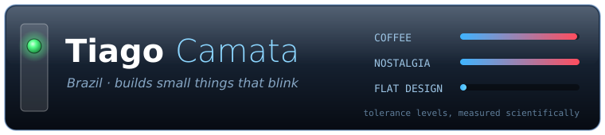

### Hi, I'm Tiago

Brazilian. Still mildly upset that desktops stopped being translucent somewhere around 2005.

I like building small tools that do one thing well and look good doing it, ideally with a blinking LED
somewhere. Usefulness is negotiable; the bevels are not.

**Projects**

- **[Nostalgic Rellm](https://github.com/tiagocamata/nostalgic-rellm)**: a translucent, skinnable hardware
  monitor bar for Windows, for people who miss Enlightenment and GKrellM.
  [Download](https://github.com/tiagocamata/nostalgic-rellm/releases/latest)

**Currently**

- Convincing modern Windows that gloss and drop shadows are features, not bugs
- Building things with an AI pair programmer that, so far, hasn't complained about the themes

---

### Oi, eu sou o Tiago

Brasileiro. Ainda levemente chateado porque os desktops deixaram de ser translúcidos lá por 2005.

Gosto de criar ferramentas pequenas que fazem uma coisa bem feita e ficam bonitas fazendo isso, de
preferência com um LED piscando em algum lugar. A utilidade é negociável; os chanfrados, não.

**Projetos**

- **[Nostalgic Rellm](https://github.com/tiagocamata/nostalgic-rellm/blob/main/README.pt-BR.md)**: uma barra
  de monitoramento de hardware translúcida e com skins para Windows, para quem sente saudade do
  Enlightenment e do GKrellM. [Baixar](https://github.com/tiagocamata/nostalgic-rellm/releases/latest)

**No momento**

- Convencendo o Windows moderno de que brilho e sombra são recursos, não defeitos
- Criando coisas com uma IA de dupla de programação que, até agora, não reclamou dos temas
